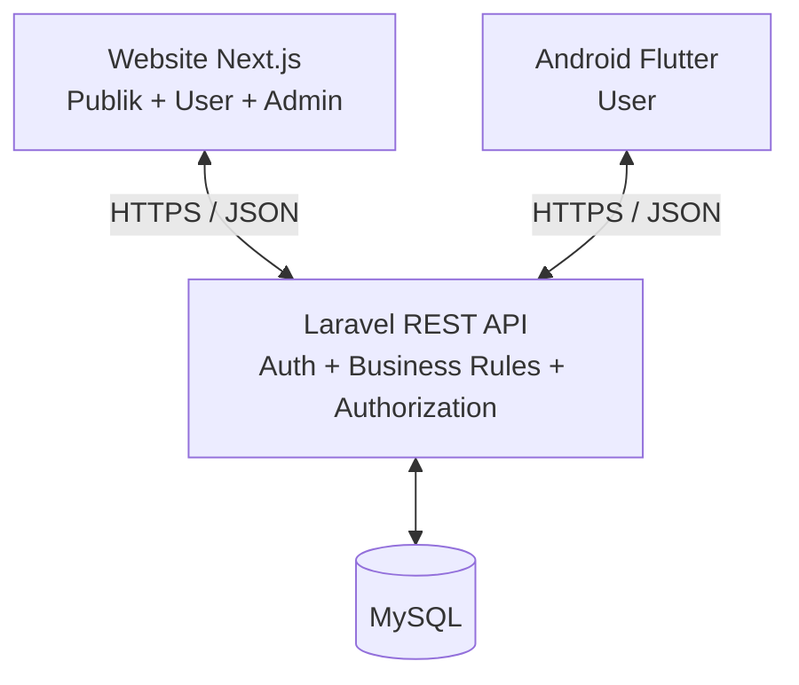

# Platform Manajemen Relawan Pengajar dan Rumah Belajar Inklusif

> **Judul TA:** Platform Web Manajemen Relawan Pengajar dan Rumah Belajar Inklusif Anak Prasejahtera (Studi Kasus: Komunitas Edukasi Kawasan Bandung Selatan)

Repository bersama untuk pengembangan **website publik/user, admin dashboard, REST API, database, dan aplikasi Android**. Dokumentasi ini menjadi acuan awal kelompok; detail kebutuhan bisnis, nama modul, dan aturan proses wajib divalidasi melalui wawancara serta kesepakatan kelompok.

## 1. Gambaran sistem

- **Website Next.js:** halaman publik dan area pengguna; admin dashboard berada di website yang sama tetapi dilindungi role/permission.
- **Android Flutter:** aplikasi khusus pengguna; tidak menyediakan admin dashboard.
- **Backend Laravel:** satu REST API untuk website dan Android.
- **Database MySQL:** sumber data tunggal untuk kedua platform.
- **Docker Compose:** lingkungan development bersama untuk MySQL, phpMyAdmin, backend, dan frontend. Flutter tetap dijalankan melalui Flutter SDK di host/emulator.



## 2. Stack yang disepakati sebagai baseline

| Layer | Teknologi | Catatan |
|---|---|---|
| Website | Next.js App Router, React, TypeScript | Buat satu aplikasi web dengan area publik, user, dan admin |
| Styling website | Tailwind CSS | Gunakan komponen konsisten; UI library opsional setelah disepakati |
| Backend | Laravel + PHP | REST API berawalan `/api/v1` |
| Auth API | Laravel Sanctum | Token untuk Android; mekanisme cookie/CSRF yang sesuai untuk website jika SPA dipisahkan |
| Database | MySQL 8.4 LTS | Skema dikelola melalui migrations, bukan perubahan manual saja |
| Android | Flutter + Dart | Konsumsi REST API yang sama |
| Container | Docker + Docker Compose | MySQL/PHP/Node dapat diseragamkan untuk development |
| Version control | Git + GitHub | Pull request, review, issue, dan branch per pekerjaan |

Versi framework/dependency final mengikuti dokumentasi resmi dan kebutuhan kompatibilitas saat proyek diinisialisasi. Lockfile (`composer.lock`, `package-lock.json`, `pubspec.lock`) harus disertakan dalam Git.

## 3. Struktur repository

```text
.
├── README.md
├── CONTRIBUTING.md
├── FRONTEND.md                 # pintasan ke panduan frontend
├── BACKEND.md                  # pintasan ke panduan backend
├── ANDROID.md                  # pintasan ke panduan Android
├── DATABASE.md                 # pintasan ke panduan database
├── DOCKER.md                   # pintasan ke panduan Docker
├── .env.example
├── .gitignore
├── .dockerignore
├── docker-compose.yml
├── docker/
│   ├── dev-backend.Dockerfile
│   └── dev-frontend.Dockerfile
├── scripts/
│   ├── bootstrap-project.ps1
│   └── bootstrap-project.sh
├── backend/                    # akan diisi skeleton Laravel
├── frontend/                   # akan diisi skeleton Next.js
├── android/                    # akan diisi skeleton Flutter
├── docs/
│   ├── README.md
│   ├── arsitektur/ARSITEKTUR.md
│   ├── perencanaan/{RUANG_LINGKUP.md,PERSYARATAN.md,ROADMAP.md,MATRIKS_MODUL.md}
│   ├── teknis/{FRONTEND.md,BACKEND.md,ANDROID.md,DATABASE.md,DOCKER.md}
│   ├── pengembangan/ALUR_GIT.md
│   ├── keamanan/KEAMANAN.md
│   ├── pengujian/PENGUJIAN.md
│   ├── deployment/DEPLOYMENT.md
│   ├── api/KONTRAK_API.md
│   ├── database/RANCANGAN_DATABASE.md
│   └── anggota/                 # panduan kerja tiap anggota
└── .github/
    ├── PULL_REQUEST_TEMPLATE.md
    └── ISSUE_TEMPLATE/
```

Folder `backend/`, `frontend/`, dan `android/` pada starter ini berisi README penanda. Jalankan script bootstrap **satu kali** untuk menghasilkan proyek framework. Script akan menghapus README penanda, lalu meminta Composer, Node/npm/npx, Flutter SDK, dan akses internet.

## 4. Persiapan komputer

Install dan verifikasi:

- Git
- Docker Desktop atau Docker Engine + Compose plugin
- PHP dan Composer (untuk bootstrap Laravel jika memakai script)
- Node.js LTS dan npm/npx (untuk bootstrap Next.js)
- Flutter SDK + Android Studio (Android SDK, emulator, atau perangkat fisik)
- VS Code atau editor yang mendukung PHP, TypeScript, Dart, Docker, dan Markdown

Panduan rinci: [`docs/README.md`](docs/README.md).

## 5. Quick start

1. Clone repository dan masuk ke foldernya.
2. Salin `.env.example` menjadi `.env`, lalu isi password development yang sesuai.
3. Jalankan `scripts/bootstrap-project.ps1` (Windows PowerShell) atau `bash scripts/bootstrap-project.sh` (macOS/Linux) **hanya saat pertama kali**.
4. Jalankan database: `docker compose --profile tools up -d mysql phpmyadmin`.
5. Ikuti langkah pertama kali Laravel dan Next.js di `docs/teknis/DOCKER.md`, `docs/teknis/BACKEND.md`, dan `docs/teknis/FRONTEND.md`; siapkan API scaffolding/Sanctum sesuai dokumentasi Laravel yang terpasang.
6. Jalankan Flutter dari folder `android/` sesuai `docs/teknis/ANDROID.md`.

Port development default: website `http://localhost:3000`, backend `http://localhost:8000`, phpMyAdmin `http://localhost:8081`, MySQL dari host `localhost:3307`. Port dan password dapat diubah pada `.env`.

> **Penting:** Compose default menjalankan database dan phpMyAdmin. Service backend/frontend berada di profile `apps`; gunakan `docker compose --profile apps up --build` setelah framework sudah dibuat dan dependensinya siap. Jangan menjalankan profile tersebut sebelum folder framework berisi file proyek yang lengkap.

## 6. Batas penting arsitektur

- Jangan mengakses MySQL langsung dari Next.js browser code maupun Flutter. Semua akses data melalui Laravel API.
- Semua otorisasi wajib diterapkan di backend; menyembunyikan tombol admin di UI tidak cukup.
- Jangan commit `.env`, API token, kredensial, dump database berisi data pribadi, file signing Android, atau data anak/relawan asli.
- Gunakan data dummy selama development dan pengujian.
- Database draft dan daftar modul dalam dokumen dapat berubah setelah validasi kebutuhan.

## 7. Dokumen utama

Mulai dari [`docs/README.md`](docs/README.md). Perubahan requirement atau endpoint perlu dicatat di dokumentasi terkait melalui pull request.
