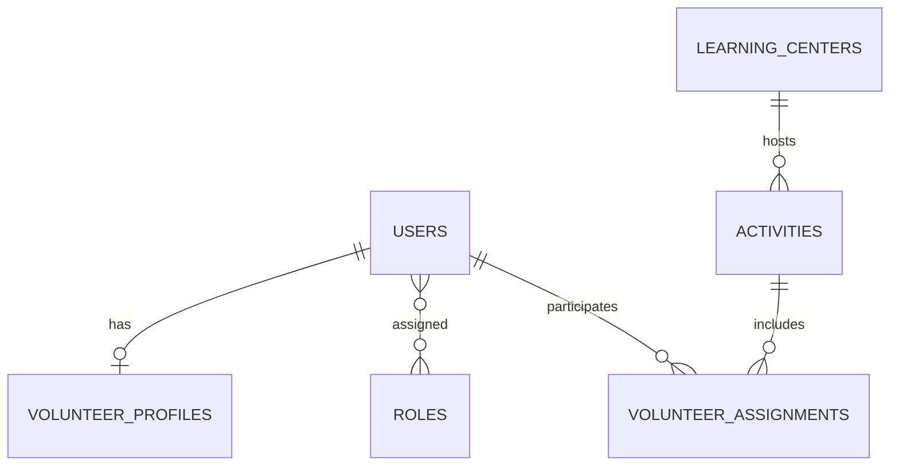

# Rancangan Database Konseptual (Draft)

> Ini rancangan awal untuk memulai diskusi, **bukan skema final atau instruksi langsung membuat semua tabel**. Validasi tiap entitas dan field melalui requirement/wawancara. Hindari menyimpan data pribadi anak atau keluarga jika tidak diperlukan.

## Kandidat entitas

| Entitas konseptual | Tujuan | Catatan validasi |
|---|---|---|
| users | Kredensial dan identitas akun | Simpan password dalam bentuk hash; jangan menjadikan akun wajib bagi semua orang tua sebelum disetujui |
| roles / permissions | Role dan izin pengguna | Pilih desain bawaan/package setelah disepakati; hindari dua sumber kebenaran |
| profiles | Data profil tambahan jika tidak cukup pada users | Tentukan field minimum dan siapa yang dapat melihat/mengubah |
| volunteer_profiles | Informasi khusus relawan | Validasi status, data kompetensi, dokumen apa yang memang dibutuhkan |
| learning_centers | Data rumah belajar | Tentukan data publik vs internal |
| activities / schedules | Aktivitas atau jadwal belajar bila masuk scope | Finalkan status dan relasi dengan rumah belajar |
| volunteer_assignments | Relasi relawan dengan aktivitas/rumah belajar bila proses memerlukannya | Perlu aturan persetujuan, status, dan duplikasi |
| audit_logs | Jejak operasi tertentu bila diperlukan | Batasi field sensitif; tentukan retensi |

## Relasi konseptual kandidat

Relasi role bisa berubah berdasarkan cara implementasi Sanctum/permission. Diagram kegiatan/penugasan hanya diperlukan bila fitur tersebut disetujui. Jangan menambahkan tabel anak atau identitas keluarga secara default tanpa alasan bisnis jelas.

## Prinsip desain

- Primary key dan foreign key konsisten.
- Indeks pada kolom yang sering digunakan untuk pencarian, join, dan unique lookup.
- Tambahkan `created_at`/`updated_at` jika sesuai kebutuhan dan konvensi Laravel.
- Dokumentasikan enum/status dan transisi legal.
- Terapkan constraint untuk mencegah duplikasi yang tidak diizinkan.
- Simpan file di storage yang sesuai dan simpan metadata/path di DB, bila fitur upload disetujui.
- Jangan menaruh file binary besar langsung di tabel kecuali ada keputusan arsitektur yang mendukungnya.
- Migration menjadi sumber kebenaran, bukan file SQL manual.

## Sebelum skema disetujui

- [ ] Tiap tabel menjawab requirement teridentifikasi.
- [ ] Field pribadi memiliki tujuan, aturan akses, dan retensi.
- [ ] Semua relasi/foreign key jelas.
- [ ] Index/unique constraint telah dipertimbangkan.
- [ ] Migration rollback dipikirkan.
- [ ] Seeder hanya menggunakan data fiktif.
- [ ] Penanggung jawab modul dan anggota backend menyetujui desain.
